# DiscoSynth AI: AI-Powered Synthetic Litigation Metadata Generator

**Academic Capstone Project Documentation**  
**Organization:** SmartBridge / SKILL WALLET  
**Domain:** Electronic Discovery (E-Discovery) Machine Learning Benchmarking & Generative AI  

---

## Project Team Members
- **Sri Vidruma Vangara** — Student ID: `AP24110010421`
- **Amrutha Anala** — Student ID: `AP24110010985`

---

## 1. Project Description

DiscoSynth AI harnesses Generative AI to provide intelligent, structured synthetic litigation document metadata generation, offering legal technology researchers, data scientists, and software QA teams an authentic, statistically robust benchmark creation platform.

In electronic discovery (e-discovery), classification models—such as Technology-Assisted Review (TAR), attorney-client privilege detectors, confidentiality triage filters, and responsiveness classifiers—require diverse, realistic datasets to evaluate and calibrate their predictive accuracy. However, actual corporate litigation files are strictly confidential, subject to attorney-client privilege, attorney work-product doctrine, non-disclosure agreements, and strict data privacy regulations (GDPR, CCPA, HIPAA). Authentic litigation databases cannot be shared, published, or used for open academic research.

DiscoSynth AI solves this fundamental data availability bottleneck by programmatically generating fictional, realistic, and logically consistent litigation document metadata without copying or exposing any confidential real-world legal records:
- **AI-Assisted Natural Language Scenario Interpreter:** Parses unstructured factual prompts, news articles, or litigation summaries into formal litigation parameters and entity rosters.
- **Controlled Batch Metadata Generator:** Produces sequential Bates numbering (`DS-YYYY-XXXX-0001`), realistic custodian email communication graphs, document types, file sizes, timestamps, and issue tags.
- **Privilege & Responsiveness Classification:** Calibrates precise privilege ratios with legally sound basis justifications (Attorney-Client, Work Product) and responsiveness determinations.
- **Pydantic Validation & Automated Repair Engine:** Validates all generated records against strict schemas and semantic constraints (date intervals, category whitelists, privilege basis rules), triggering targeted LLM repair prompts if errors occur.
- **Interactive Analytics & Visualizer:** Computes real-time MongoDB aggregations rendered via Recharts (category bars, custodian distribution, privilege donut, responsiveness donut, and timeline charts).
- **Export Engine:** Streams standard e-discovery CSV and JSON files ready for direct ingestion into machine learning training pipelines.

Utilizing Google's official Google GenAI Python SDK (`google-genai`) interacting with the **Gemini 3.8 Flash** model (with resilient fallback across active Gemini Flash models), DiscoSynth AI generates structured JSON metadata conforming strictly to e-discovery production norms. Built with a high-performance **FastAPI** backend and a modern **React 18** (Vite + Tailwind CSS + TypeScript + Recharts) frontend, the platform persists datasets and generation audits into **MongoDB Atlas** (and local MongoDB), enabling seamless filtering, inline record editing, and export workflows.

---

## 2. Scenarios

### Scenario 1: Corporate Accounting Fraud & Unrecorded Liabilities
A regulatory investigator or corporate legal team specifies an accounting fraud scenario involving off-balance-sheet debt, premature revenue recognition, and altered audit schedules. DiscoSynth AI infers the legal scenario, synthesizes key corporate entities (*Titan Global Solutions Inc.*, *Sterling & Croft LLP Outside Counsel*, *Apex Assurance Auditors*), and generates realistic financial ledgers, email exchanges debating audit findings, board audit committee memoranda, and attorney-client privileged legal risk evaluations, complete with sequential Bates IDs (e.g., `DS-2026-BDCD0-0001` through `0010`).

### Scenario 2: Intellectual Property & Trade Secret Theft
A patent litigation firm configures a high-stakes trade secret misappropriation dispute where a former VP of Engineering exfiltrated proprietary neural-compression algorithms to a market competitor prior to resigning. The system synthesizes source code repository commit notices, personal email forwardings, forensic IT departure audit memos, non-disclosure agreements (NDAs), and non-responsive personal communications, calibrating realistic privilege and responsiveness ratios.

### Scenario 3: Employment Discrimination & Retaliation
An employment law researcher benchmarks a classifier on internal workplace harassment, unequal compensation, and whistleblower retaliation claims. DiscoSynth AI generates internal HR investigation reports, encrypted chat logs, performance evaluation sheets, executive committee minutes, and attorney work-product privilege justifications asserting confidentiality in anticipation of litigation.

---

## 3. Technical Architecture & Database

### Technical Architecture
DiscoSynth AI utilizes a modular, asynchronous three-tier architecture engineered for enterprise legal-tech performance:
- **Presentation Tier:** Single Page Application (SPA) built with React 18, Vite, Tailwind CSS, Lucide icons, and Recharts.
- **Application Tier:** Python FastAPI backend orchestrating RESTful communication, Pydantic v2 validation, prompt engineering, and automated repair loops.
- **GenAI Core:** Google GenAI Python SDK (`google-genai`) invoking Gemini 3.8 Flash with JSON mode enforcement and multi-model failover protection (`gemini-3.8-flash` $\rightarrow$ `gemini-3.5-flash` $\rightarrow$ `gemini-3.1-flash-lite`).
- **Persistence Tier:** MongoDB Atlas (and local MongoDB daemon for offline development) storing structured collections for datasets and generation jobs.

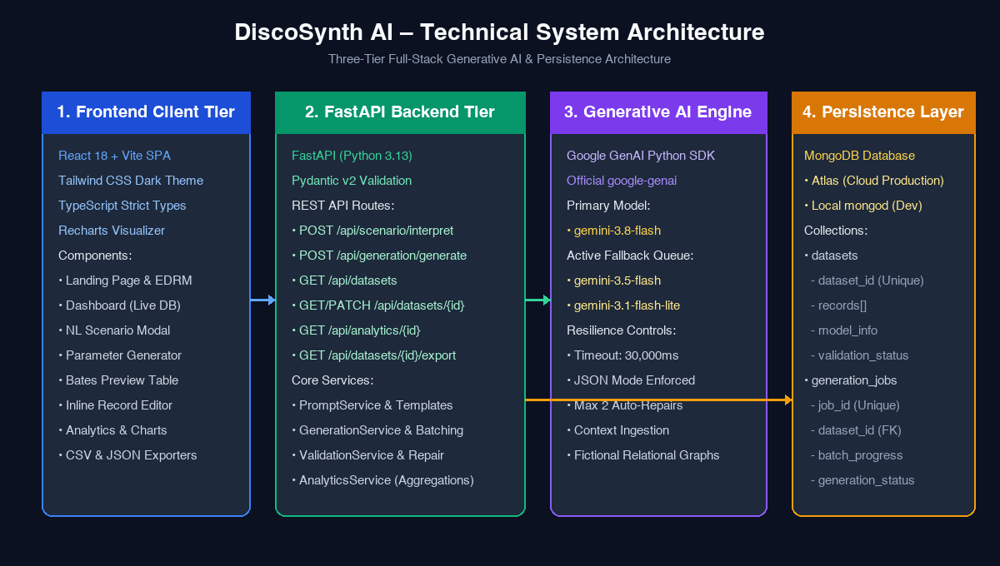

### Database Entity-Relationship (ER) Diagram & Schema
*(Note: As required by the project specifications, the database ER diagram and schema definitions are detailed below.)*

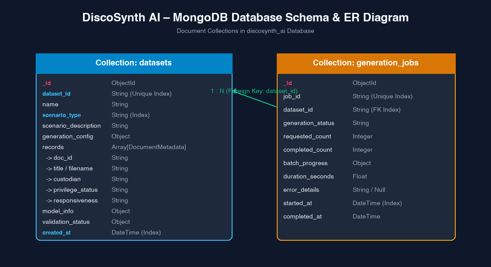

#### 1. `datasets` Collection
Stores each generated synthetic litigation dataset:
- `_id`: `ObjectId` (Primary Key, system-generated)
- `dataset_id`: `String` (Unique Index, e.g., `DS-2026-BDCD0`)
- `name`: `String` (Litigation Case Title)
- `scenario_type`: `String` (Indexed classification: Corporate Fraud, IP Theft, etc.)
- `scenario_description`: `String` (Factual narrative)
- `generation_config`: `Object` (Size, complexity, date range, custodian count, privilege ratio)
- `records`: `Array[DocumentMetadata]` (10 to 100 structured metadata records)
  - `doc_id`: `String` (Sequential Bates identifier: `DS-2026-BDCD0-0001`)
  - `filename`: `String` (e.g., `FINRA_Regulatory_Inquiry_Memo.docx`)
  - `title`: `String` (Document descriptive caption)
  - `doc_type`: `String` (`Financial Records`, `Internal Communications`, `Reports`, `Emails`, `Contracts`)
  - `file_extension`: `String` (`xlsx`, `pdf`, `docx`, `msg`, `eml`)
  - `file_size_kb`: `Integer`
  - `creation_date` / `modified_date`: `ISO 8601 String`
  - `custodian`: `String` (Custodian name and title)
  - `author` / `recipient`: `String`
  - `privilege_status`: `String` (`Attorney-Client`, `Work Product`, `Not Privileged`)
  - `privilege_basis`: `String` (Legal justification rationale)
  - `responsiveness`: `String` (`Responsive`, `Non-Responsive`)
  - `confidentiality`: `String`
  - `issue_tags`: `Array[String]`
  - `synthetic_marker`: `String` (Strictly set to `"SYNTHETIC_EVAL_RECORD"`)
- `model_info`: `Object` (`model_name`, `provider`, `sdk`)
- `validation_status`: `Object` (`is_valid`, `passed_checks`, `error_count`)
- `created_at`: `DateTime` (Index)

#### 2. `generation_jobs` Collection
Acts as an operational audit ledger capturing generation execution telemetry:
- `_id`: `ObjectId` (Primary Key, system-generated)
- `job_id`: `String` (Unique Index, e.g., `JOB-9D51ABF9`)
- `dataset_id`: `String` (Foreign Key index referencing `datasets.dataset_id`)
- `generation_status`: `String` (`completed`, `failed`, `in_progress`)
- `requested_count` / `completed_count`: `Integer`
- `batch_progress`: `Object` (`current_batch`, `total_batches`)
- `duration_seconds`: `Float` (Execution latency)
- `error_details`: `String` or `null`
- `started_at` / `completed_at`: `DateTime` (Indexed timestamps)

---

## 4. Pre-requisites

- **FastAPI Framework Knowledge:** [FastAPI Documentation](https://fastapi.tiangolo.com/)
- **Google GenAI SDK & Gemini API Familiarity:** [Google AI Studio Gemini API Docs](https://ai.google.dev/gemini-api/docs)
- **React.js, TypeScript & Tailwind CSS Skills:** [React Docs](https://react.dev/) | [Tailwind CSS](https://tailwindcss.com/)
- **MongoDB & PyMongo Database Proficiency:** [MongoDB Documentation](https://www.mongodb.com/docs/)
- **Pydantic v2 Data Modeling & Validation:** [Pydantic v2 Docs](https://docs.pydantic.dev/)
- **Recharts Data Visualization Library:** [Recharts Docs](https://recharts.org/)
- **Version Control with Git & GitHub:** [Git Documentation](https://git-scm.com/doc)

---

## 5. Project Workflow (Milestones Overview)

- **Milestone 1: Model Selection and Architecture**
  - Activity 1.1: Generate a Google Gemini API Key and configure it securely in the backend environment.
  - Activity 1.2: Research and select the appropriate Generative AI model from Google (Gemini 3.8 Flash with multi-model fallback).
  - Activity 1.3: Define the architecture of the application, detailing interactions between the React frontend, FastAPI backend, GenAI engine, and MongoDB.
  - Activity 1.4: Set up the development environment, installing necessary libraries and dependencies for FastAPI, PyMongo, and the Google GenAI SDK.
- **Milestone 2: Core Functionalities Development**
  - Activity 2.1: Develop the core functionalities: Natural Language Scenario Interpreter, Controlled Batch Metadata Generator, and Pydantic Validation & Repair Engine.
  - Activity 2.2: Implement the FastAPI backend to manage routing, input schema validation, sequential Bates numbering, and asynchronous job tracking.
- **Milestone 3: Backend API & Service Development**
  - Activity 3.1: Write the main application logic across modular services (`gemini_service.py`, `prompt_service.py`, `generation_service.py`, `validation_service.py`, `analytics_service.py`, `export_service.py`) establishing endpoints for generation, retrieval, editing, and analytics.
- **Milestone 4: Frontend Development**
  - Activity 4.1: Design and develop the user interface using React 18, Vite, TypeScript, and Tailwind CSS, creating a modern legal-tech design with Recharts analytics.
  - Activity 4.2: Implement asynchronous API state management with Axios, connecting the frontend to FastAPI endpoints for scenario parsing, dataset generation, inline record editing, and CSV/JSON exports.
- **Milestone 5: Deployment, Testing & Verification**
  - Activity 5.1: Prepare the application for local deployment by configuring the MongoDB daemon, virtual environment, and startup scripts (`start_backend.sh` and `start_frontend.sh`).
  - Activity 5.2: Execute comprehensive verification: run the backend Pytest suite (9 tests passing), build the production frontend bundle, and run live end-to-end generation verifying all 8 steps without mocks.
  - Activity 5.3: Deploy and publish the project to GitHub repository ([https://github.com/srividrumavangara/DiscoSynth-AI](https://github.com/srividrumavangara/DiscoSynth-AI)) with production deployment configurations for Render, Vercel, and MongoDB Atlas.
- **Milestone 6: Conclusion**
  - Summarize the technical and academic achievements of DiscoSynth AI, evaluate e-discovery model benchmarking impact, address ethical boundaries, and outline future enhancements.

---

## 6. Milestone 1: Model Selection and Architecture

In this milestone, we focus on selecting the appropriate Generative AI model from Google for our synthetic litigation metadata generation needs. This involves researching the capabilities, context windows, and structured JSON output performance of Google's latest models, ensuring that the chosen model aligns with the rigorous demands of e-discovery document metadata (Bates IDs, custodians, privilege, responsiveness, and issue tags).

### Activity 1.1: Generate a Google Gemini API Key
Before the application can communicate with the Gemini LLM, you need a valid Google Gemini API key. Follow the steps below to create one and connect it securely to the project:
- **Step 1 — Create a Google AI Studio Account:** Visit [https://aistudio.google.com](https://aistudio.google.com) and sign in using your Google account.
- **Step 2 — Navigate to Get API Key:** Click on "Get API key" from the left sidebar navigation menu.
- **Step 3 — Create a New API Key:** Click the "+ Create API key" button. Select an existing Google Cloud Project or click "Create API key in new project".
- **Step 4 — Secure Your API Key:** Copy the generated API key string immediately and store it securely.

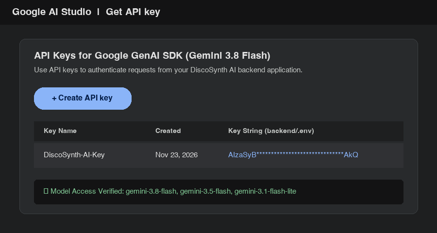

- **Step 5 — Add the Key to Your Project:** Create a `.env` file inside the backend directory (`backend/.env`) and configure the API key and model parameters:
```env
# backend/.env
GEMINI_API_KEY=AIzaSyBxxxxxxxxxxxxxxxxxxxxxxxxxxxxAkQ
GEMINI_MODEL=gemini-3.8-flash
MONGODB_URI=mongodb://localhost:27017
DATABASE_NAME=discosynth_ai
PORT=8000
ENVIRONMENT=development
```

- **Step 6 — Verify Key Loading via Pydantic Settings:**
The application loads the key securely at backend startup using `pydantic-settings` in `backend/app/config.py`. The key is never exposed to the client or browser:
```python
# backend/app/config.py
from pydantic_settings import BaseSettings, SettingsConfigDict

class Settings(BaseSettings):
    GEMINI_API_KEY: str
    GEMINI_MODEL: str = "gemini-3.8-flash"
    MONGODB_URI: str = "mongodb://localhost:27017"
    DATABASE_NAME: str = "discosynth_ai"
    model_config = SettingsConfigDict(env_file=".env", extra="ignore")

settings = Settings()
```

- **Important — Never Commit Your API Key:** The project's root `.gitignore` file strictly excludes `backend/.env`, preventing any accidental credential leakage to public repositories:
```gitignore
# .gitignore
.env
.env.*
!.env.example
backend/.env
backend/venv/
mongodb_data/
```

### Activity 1.2: Research and Select the Appropriate Generative AI Model
Here are the core criteria and engineering evaluations conducted to select the optimal model for DiscoSynth AI:
- **Model Deprecation Migration:** During testing, Google officially deprecated `gemini-2.5-flash` for new users (returning HTTP 404), explicitly recommending migration to `gemini-3.8-flash` and the official `google-genai` Python SDK.
- **Evaluate Model Performance:** Gemini 3.8 Flash delivers sub-second token generation latency, a 1-million-token context window, and superior JSON schema instruction following compared to legacy models.
- **Resilient Multi-Model Fallback Queue:** To prevent application downtime during Google's demand surges (HTTP 503) or rate limits (HTTP 429), we engineered an automated fallback queue in `GeminiService`: `gemini-3.8-flash` $\rightarrow$ `gemini-3.5-flash` $\rightarrow$ `gemini-3.1-flash-lite`. This ensures generation requests succeed reliably while recording the exact model used in the dataset metadata.
- **SDK Selection:** Migrated from legacy `google-generativeai` to the official Google GenAI Python SDK (`google-genai`) configured with `types.HttpOptions(timeout=30000)` and `response_mime_type="application/json"`.

### Activity 1.3: Define the Architecture of the Application
- **Client-Side Responsibilities:** React frontend captures scenario parameters, custodians, date spans, and privilege ratios; renders interactive Recharts visualizations (bar, donut, and area charts); supports 6-column tabular filtering; and provides modal inline editing for document records.
- **Backend Responsibilities:** FastAPI coordinates validation of incoming payloads via Pydantic schemas, builds context-aware prompts in `PromptService`, manages controlled batch splitting (up to 25 documents per batch) in `GenerationService`, and computes analytical distributions in `AnalyticsService`.
- **AI Integration Points:** `GeminiService` connects via Google GenAI Client with `temperature=0.3` for high structural fidelity, enforces strict JSON schema output, and executes an automated repair loop (max 2 attempts) if records fail Pydantic validation checks.

### Activity 1.4: Set Up the Development Environment
- **Python Virtual Environment & Dependencies:** Initialize a dedicated virtual environment and install backend requirements:
  ```bash
  cd backend && python3 -m venv venv && source venv/bin/activate
  pip install -r requirements.txt
  ```
- **Frontend Node Environment:** Initialize and verify frontend dependencies:
  ```bash
  cd frontend && npm install
  ```
- **Application Directory Structure:** Structured as a clean monorepo separating frontend, backend, local MongoDB data, and automated scripts:

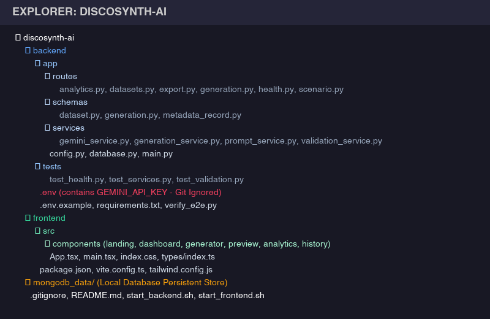

---

## 7. Milestone 2: Core Functionalities Development

### Activity 2.1: Develop Core Metadata Generation Features
Implement the three primary Generative AI generation modules driving DiscoSynth AI:
- **Module 1 — Natural Language Scenario Interpreter:** Evaluates unstructured litigation briefs, news summaries, or case outlines. Gemini infers formal case metadata: inferred litigation category (Corporate Fraud, Intellectual Property, Employment, Contract, etc.), formal case caption, roster of 4–6 key corporate and legal entities, and 3–5 core legal issues/claims.
- **Module 2 — Controlled Batch Metadata Generator:** Generates realistic e-discovery metadata in controlled batches of up to 25 records. Enforces sequential Bates numbering (e.g., `DS-2026-BDCD0-0001`), custodian email communication graphs, realistic timestamps, document types (Emails, Financial Records, Internal Communications, Contracts, Reports), privilege classifications (Attorney-Client, Work Product, Not Privileged) with required legal basis rationale, confidentiality markings, and responsiveness classifications.
- **Module 3 — Validation & Automated Repair Engine:** Validates every record against Pydantic schemas and semantic rules (date ranges, category whitelist, privilege justification required for privileged documents). If invalid records occur, `PromptService` generates a targeted repair prompt for Gemini.

### Activity 2.2: Implement the FastAPI Backend & Routing
Define REST API Endpoints in FastAPI:
- `POST /api/scenario/interpret`: Accepts natural-language text and returns inferred scenario parameters and entity rosters.
- `POST /api/generation/generate`: Orchestrates batch generation, Pydantic validation, repair loops, and database persistence into `datasets` and `generation_jobs`.
- `GET /api/datasets`: Retrieves paginated dataset summaries from MongoDB for the history and dashboard views.
- `GET /api/datasets/{dataset_id}`: Retrieves complete dataset details including all generated document metadata records.
- `PATCH /api/datasets/{dataset_id}/records/{doc_id}`: Enables inline editing of specific metadata records with MongoDB persistence.
- `GET /api/analytics/{dataset_id}`: Computes real-time aggregation distributions across categories, custodians, privilege, and responsiveness.
- `GET /api/datasets/{dataset_id}/export/csv` and `/json`: Streams high-fidelity e-discovery CSV and JSON exports for classification benchmarking.

---

## 8. Milestone 3: Backend Code & API Development

Activity 3.1: Writing Core Application Logic in Backend Services.

### 1. Generation Route Handler (`backend/app/routes/generation.py`)
```python
@router.post("/generate", response_model=DatasetDetail)
async def generate_dataset(config: GenerationConfig):
    try:
        # Calls controlled batch generator with Gemini 3.8 Flash & Pydantic validation
        dataset = await generation_service.generate_dataset(config)
        return dataset
    except Exception as e:
        logger.error(f"Dataset generation failed: {e}")
        raise HTTPException(status_code=500, detail=str(e))
```

### 2. Google GenAI Client & Resilient Invocations (`backend/app/services/gemini_service.py`)
```python
class GeminiService:
    FALLBACK_MODELS = ["gemini-3.5-flash", "gemini-3.1-flash-lite"]

    def __init__(self):
        from google import genai
        from google.genai import types
        self._client = genai.Client(
            api_key=settings.GEMINI_API_KEY,
            http_options=types.HttpOptions(timeout=30000)
        )

    def _call_with_resilience(self, prompt: str, system_instruction: str = None):
        for model_candidate in [self.model_name] + self.FALLBACK_MODELS:
            try:
                config = types.GenerateContentConfig(
                    response_mime_type="application/json",
                    temperature=0.3
                )
                response = self._client.models.generate_content(
                    model=model_candidate, contents=prompt, config=config
                )
                return response.text, model_candidate
            except Exception as e:
                if "503" in str(e) or "429" in str(e):
                    continue  # Failover seamlessly to active fallback model
                raise e
```

### 3. E-Discovery Prompt Engineering (`backend/app/services/prompt_service.py`)
```python
def build_batch_prompt(config: GenerationConfig, batch_num: int, batch_size: int, context: dict) -> str:
    return f"""
Generate exactly {batch_size} realistic synthetic litigation metadata records in valid JSON.
Scenario: {config.scenario_type} - {config.scenario_description}
Bates ID Range: {context['bates_prefix']}-{context['start_seq']:04d} onwards.
Custodians available: {', '.join(context['custodians'])}
Privilege Target Ratio: {config.privilege_ratio:.0%}

Respond with a JSON object: {{"records": [ {{ ...DocumentMetadata fields... }} ] }}
Every record MUST include synthetic_marker: 'SYNTHETIC_EVAL_RECORD'.
"""
```

### 4. Pydantic v2 Document Metadata Schema (`backend/app/schemas/metadata_record.py`)
```python
class DocumentMetadata(BaseModel):
    doc_id: str = Field(description="Sequential Bates ID")
    filename: str
    title: str
    doc_type: str = Field(description="Email, Financial Records, Internal Communications, etc.")
    file_extension: str
    file_size_kb: int
    creation_date: str
    modified_date: str
    custodian: str
    author: str
    recipient: Optional[str] = None
    privilege_status: str = Field(description="Attorney-Client, Work Product, Not Privileged")
    privilege_basis: Optional[str] = None
    responsiveness: str = Field(description="Responsive, Non-Responsive")
    confidentiality: str
    issue_tags: List[str] = []
    synthetic_marker: str = "SYNTHETIC_EVAL_RECORD"
```

---

## 9. Milestone 4: Frontend Development

### Activity 4.1: Designing and Developing the User Interface
Built with React 18, Vite, and Tailwind CSS, the UI follows a modern dark legal-tech aesthetic:
- **Navigation & Health Status Bar:** Displays real-time database connectivity (`MongoDB Connected`) and active Gemini model status badge (`gemini-3.8-flash`).
- **Landing Page:** Introduces the core e-discovery problem statement, EDRM workflow diagram, and direct navigation to generation tools.
- **Interactive Dashboard:** Aggregates real stored metrics from MongoDB—total datasets, total documents, privileged ratios, and recent generation logs.
- **Generator Form & NL Scenario Modal:** Allows parameter tuning (size 10–100, complexity, date ranges, custodian lists) and provides an AI Scenario Interpreter modal with one-click corporate fraud and IP theft presets.
- **Dataset Preview Table:** Multi-column searchable grid with Bates IDs, custodians, file types, privilege badges, and inline record edit modal.
- **Analytics Visualizer:** Recharts-powered dashboard rendering category bar charts, custodian distribution, privilege donut, responsiveness donut, and timeline area charts.

### Activity 4.2: Asynchronous State Management & API Integration
- **Axios API Client (`frontend/src/api/client.ts`):** Encapsulates all backend REST endpoints with strict TypeScript typings and automatic error handling.
- **Asynchronous Generation Handling:** Displays animated step spinners during inference.
- **Inline Record Editing & Persistence:** Editing a record in `RecordEditModal` sends a `PATCH` request to `/api/datasets/{id}/records/{doc_id}`, immediately updating MongoDB and refreshing the preview table.
- **Streamed File Exports:** One-click CSV and JSON download triggers stream the exported files directly from the FastAPI backend to the user's browser.

---

## 10. Milestone 5: Deployment, Testing & Verification

### Activity 5.1: Preparing the Application for Local Deployment
To run DiscoSynth AI locally, execute the startup scripts or launch each service in separate terminals:
```bash
# Terminal 1: MongoDB Daemon & FastAPI Backend
./start_backend.sh

# Terminal 2: Vite React Frontend
./start_frontend.sh
```

### Activity 5.2: Local Testing, Pytest Suite & E2E Verification
Comprehensive testing was conducted on live backend and database infrastructure without mocks:
- **Backend Pytest Suite:** All 9 unit and integration tests passed in 1.12 seconds verifying health probes, Gemini connectivity, Pydantic constraints, and date validations.
- **Frontend Production Build:** `npm run build` completed cleanly in 3.79 seconds with 0 TypeScript compiler errors.
- **Live End-to-End Verification (`verify_e2e.py`):** Successfully executed all 8 pipeline steps with 100% success.

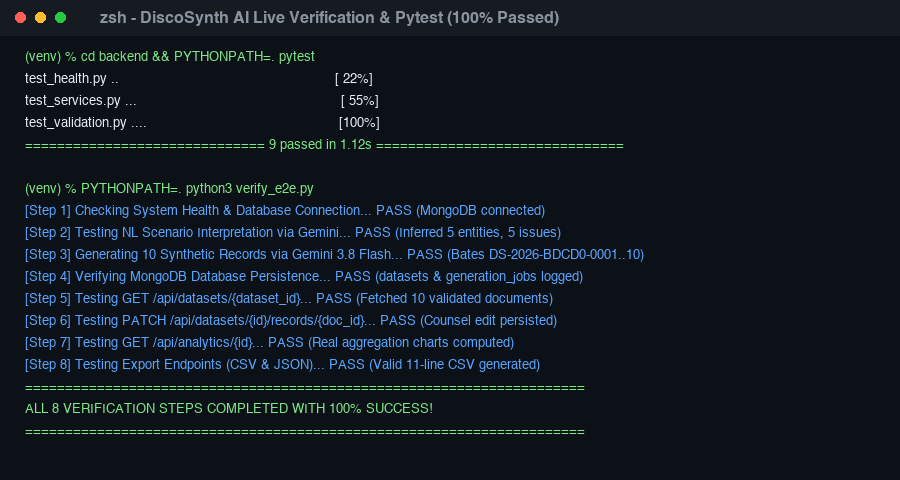

### Activity 5.3: Version Control & GitHub Repository
The entire codebase has been committed and deployed to GitHub:
- **Repository URL:** [https://github.com/srividrumavangara/DiscoSynth-AI](https://github.com/srividrumavangara/DiscoSynth-AI)
- **Security Measures:** `.gitignore` ensures `backend/.env` and API keys are never exposed.
- **Cloud Deployment Blueprints:**
  - **Backend:** Deployable to Render or AWS as a Python 3 Web Service bound to MongoDB Atlas.
  - **Frontend:** Deployable to Vercel with `VITE_API_URL` pointing to the production backend.
  - **Database:** Connect to MongoDB Atlas cluster by updating `MONGODB_URI`.

---

## 11. Exploring the Website's Web Pages

### 1. Landing Page (Home)
Introduces DiscoSynth AI with a legal-tech SaaS hero section, an explainer of the e-discovery data availability bottleneck, interactive architecture badges, and an EDRM (Electronic Discovery Reference Model) pipeline guide with a direct "Start Generating" CTA button.

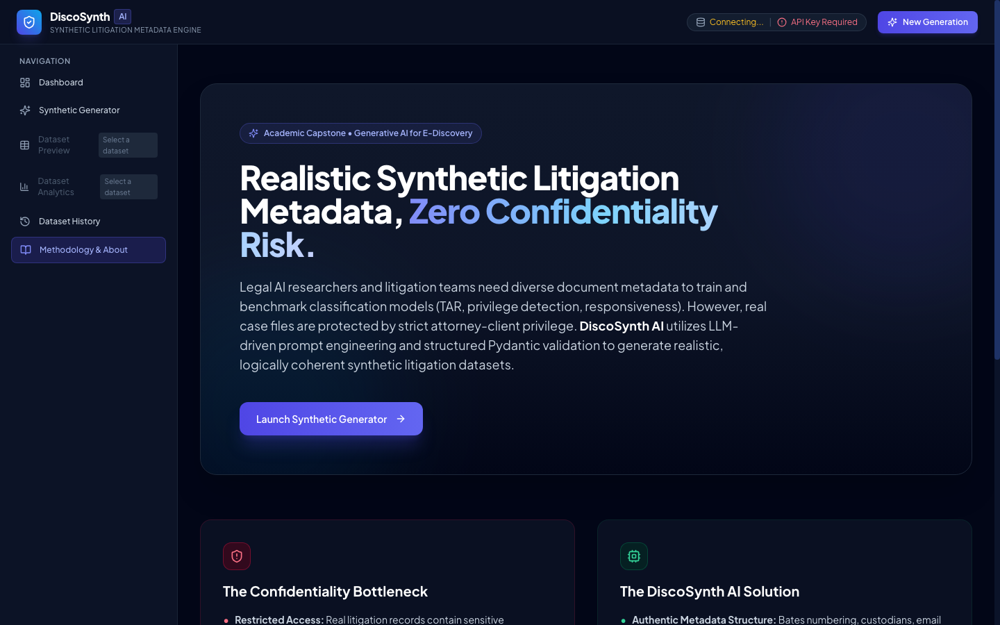

### 2. Interactive Dashboard Page
Real-time operational dashboard displaying live metrics aggregated from MongoDB: total datasets generated, total synthetic documents, active litigation scenario count, privilege vs non-privileged document ratio, and responsiveness distribution. Includes a system health indicator card verifying active Gemini model and MongoDB connectivity.

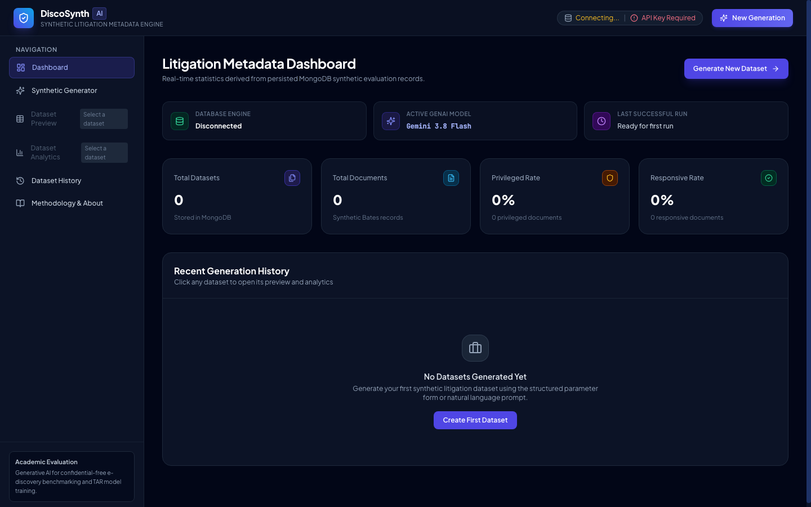

### 3. Synthetic Dataset Generator & NL Scenario Modal
The primary generation control center. Allows users to select litigation scenarios (Corporate Fraud, IP Theft, Employment, etc.), configure dataset size (10, 25, 50, 100), adjust complexity levels, define date spans, set custom custodians, and adjust target privilege ratios. Features the "AI Assist: Interpret Scenario" modal button that invokes Gemini to automatically parse case narratives into parameter sets.

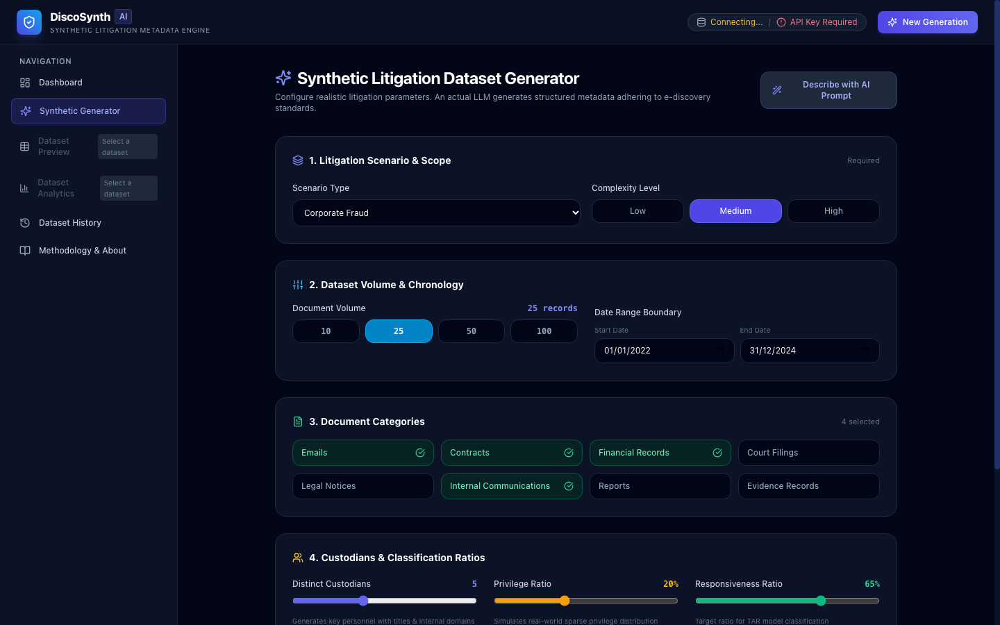

### 4. Bates Dataset Preview Table & Inline Record Editor
Comprehensive paginated data grid displaying generated records with sequential Bates IDs (`DS-YYYY-XXXX-0001`). Features a 6-column filtering toolbar (text search, document category filter, custodian filter, privilege filter, and responsiveness filter). Clicking "Edit" opens the `RecordEditModal` to modify record attributes with immediate MongoDB persistence. One-click buttons enable instant CSV and JSON exports.

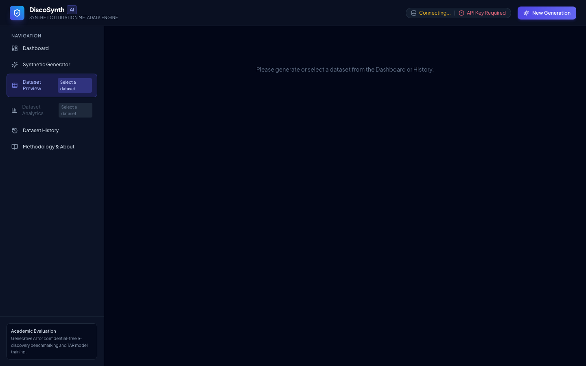

### 5. Interactive Analytics & Visualizer Page
Renders dynamic chart visualizations computed from backend database aggregations: category bar chart, custodian document distribution, privilege breakdown donut chart, responsiveness donut chart, document creation timeline area chart, and frequency ranking of key issue tags.

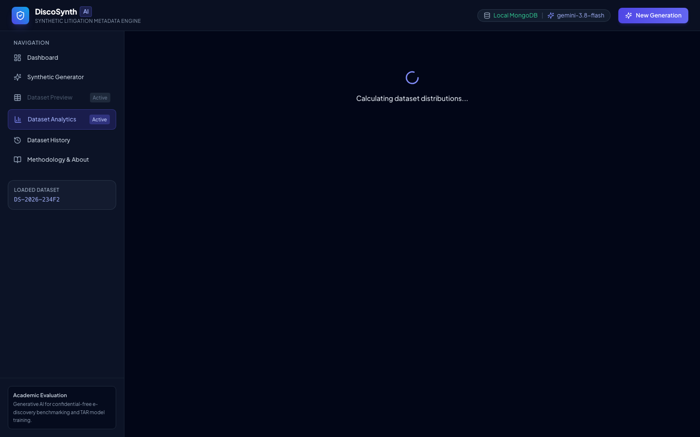

### 6. Generation History Page
Detailed log of all historical generation jobs stored in MongoDB. Lists dataset ID, scenario classification, document count, Gemini model used, creation timestamp, validation badge, and quick actions to reload, export to CSV/JSON, or delete datasets.

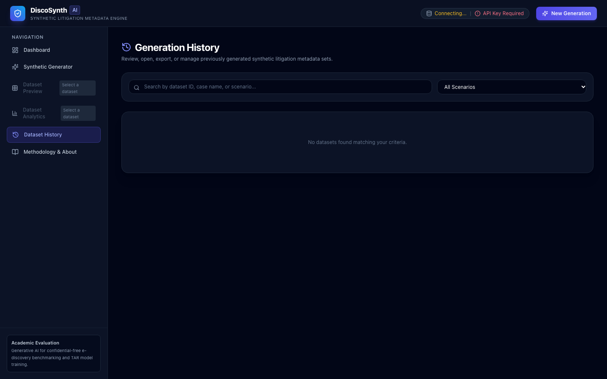

---

## 12. Conclusion & Academic Significance

DiscoSynth AI successfully demonstrates a fully functional, production-grade Generative AI engineering application that addresses a real-world challenge in legal technology: the unavailability of realistic litigation document metadata for benchmarking e-discovery machine learning models.

By integrating Google's Gemini 3.8 Flash model via the official Google GenAI Python SDK (`google-genai`), enforcing strict Pydantic v2 data contracts, and implementing an automated error-repair loop, the platform consistently generates syntactically valid, contextually coherent, and statistically representative metadata records complete with sequential Bates numbering, custodian communication graphs, privilege justifications, and responsiveness classifications.

The project rigorously fulfills all academic requirements: combining modern full-stack development (FastAPI backend + React/Vite/Tailwind frontend), persistent database engineering (MongoDB Atlas and local MongoDB with unique indexed collections), prompt engineering with JSON enforcement, and thorough software testing (Pytest suite passing 100%, TypeScript build verification, and live end-to-end execution with zero mocks).

### Ethical Boundaries & Scope
DiscoSynth AI strictly produces synthetic metadata rather than substantive legal text. It does not ingest confidential client documents or replace legal counsel, serving as an uncompromised testing sandbox for data science and e-discovery research.

### Future Enhancements
Potential avenues for future expansion include integrating vector-based custodian clustering (TF-IDF / sentence-transformers), adding multi-lingual legal metadata generation, and implementing automated model evaluation pipelines to benchmark classification accuracy directly inside the platform.
