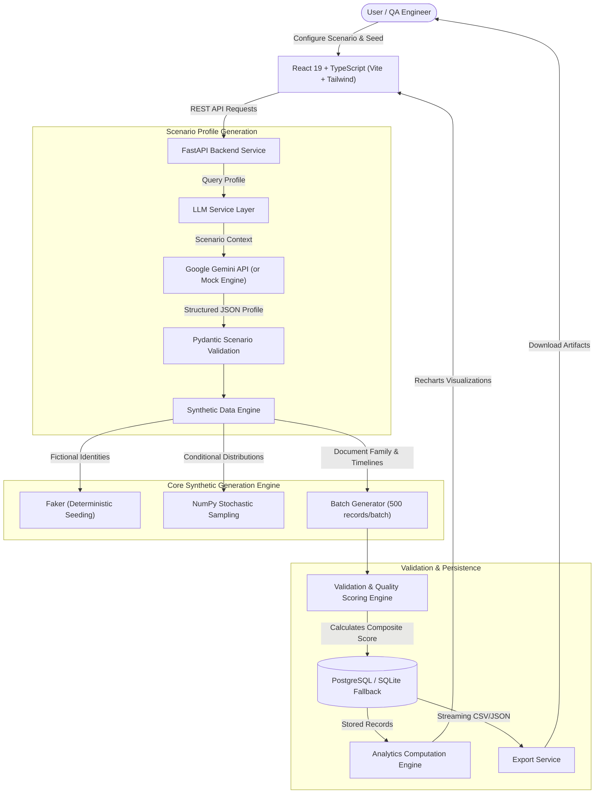

# DiscoSynth AI – Synthetic Litigation Metadata Generator

[](LICENSE)
[](https://www.python.org/)
[](https://fastapi.tiangolo.com/)
[](https://react.dev/)
[](https://www.typescriptlang.org/)
[](https://vitejs.dev/)
[](https://tailwindcss.com/)

**DiscoSynth AI** is an AI-assisted synthetic litigation metadata generator designed specifically for electronic discovery (e-discovery) benchmarking, legal-tech software QA, and machine learning model validation.

---

## 1. Problem Statement

Modern litigation produces massive collections of electronic records (emails, memos, spreadsheets, contracts, and presentations) that must undergo rigorous document review under the Electronic Discovery Reference Model (EDRM).

However, data access remains a major bottleneck in legal-technology research:
- **Strict Confidentiality & Privilege:** Organizations cannot share authentic litigation databases due to attorney-client privilege, work-product doctrine, NDAs, and trade secrecy.
- **Privacy Regulations:** Statutes such as GDPR, CCPA, and HIPAA strictly prohibit the unredacted release of personally identifiable information (PII) and corporate records.
- **Need for Realistic Benchmark Sets:** Data scientists and legal-tech engineers require rich, logically coherent metadata datasets—featuring realistic responsiveness rates, privilege rates, custodian distributions, document families, and issue tags—to benchmark classification systems and search algorithms.

**DiscoSynth AI solves this problem** by programmatically generating *fictional but logically consistent litigation document metadata*. It requires **no confidential case input**, contains **no real identities**, and generates **metadata only** (not substantive legal text), creating an uncompromised testing sandbox.

---

## 2. Solution Architecture

DiscoSynth AI implements a **hybrid generation architecture** combining stochastic modeling with LLM contextual profiles:



---

## 3. Technology Stack

### Frontend
- **Framework:** React 19 (TypeScript)
- **Tooling:** Vite 6
- **Styling:** Tailwind CSS v4 (Custom Legal-Tech Palette: Deep Navy & Royal Violet)
- **Data Visualization:** Recharts
- **Icons:** Lucide React
- **Routing:** React Router v7
- **HTTP Client:** Axios

### Backend
- **Framework:** Python 3.12+ / FastAPI
- **Data Validation & Schemas:** Pydantic v2 & Pydantic-Settings
- **ORM & Database:** SQLAlchemy 2.0 (PostgreSQL in production; SQLite local dev fallback)
- **Data Engineering:** NumPy 2.2, Pandas 2.2, Faker 33.1
- **Testing:** Pytest 8.3, FastAPI TestClient

### Generative AI
- **LLM Provider:** Configurable via `LLM_PROVIDER` environment variable
  - `gemini`: Uses Google Gemini 1.5 Flash (`google-generativeai`) with structured JSON schema output
  - `mock`: Built-in zero-dependency deterministic scenario profile engine (no API key required)

### Deployment & Infrastructure
- **Containerization:** Docker & Docker Compose
- **Production Backend:** Render / Railway (with Managed PostgreSQL)
- **Production Frontend:** Vercel / Nginx Alpine container

---

## 4. Key Features

- **6 Pre-Engineered Litigation Scenarios:**
  - Corporate Fraud (accounting irregularities, insider trading, wire fraud)
  - Intellectual Property Dispute (patent infringement, trade secrets, reverse engineering)
  - Employment Litigation (discrimination, wrongful termination, retaliation)
  - Financial Misconduct (AML/KYC violations, offshore transactions, sanctions)
  - Contract Dispute (SLA breach, force majeure, warranty failure)
  - Custom Scenario (user-configurable parameters)
- **Conditional Probability Engine:**
  - *Role-Privilege Correlation:* Documents involving in-house counsel or executives exhibit statistically higher privilege and redaction probabilities.
  - *Channel Authenticity:* Communication channels (Outlook, Exchange, Lotus Notes) only attach to email document types.
  - *Chronological Integrity:* `date_modified` is strictly bounded and cannot precede `date_created`.
  - *Document Family Groups:* Generates parent-child attachment structures with realistic attachment count distributions.
- **Multidimensional Quality Scoring Engine:**
  - Assesses each dataset across 5 transparent dimensions:
    1. Schema Validity (25% weight)
    2. Completeness of Required Fields (25% weight)
    3. Document ID Uniqueness (20% weight)
    4. Logical & Relational Consistency (20% weight)
    5. Target Distribution Adherence (10% weight)
- **Interactive SaaS Analytics:**
  - Real-time Recharts visualizations for document type breakdown, responsiveness ratio, privilege distribution, confidentiality tiers, document creation timeline, and top 10 issue tag frequencies.
- **Standards-Compliant Exports:**
  - Streaming CSV (compatible with Pandas, Scikit-learn, and Relativity imports)
  - Formatted JSON with dataset manifest and synthetic disclaimer headers.
- **Deterministic Seeding:**
  - Providing the same numeric seed and parameters produces bit-for-bit identical datasets.

---

## 5. Synthetic Metadata Schema

Each synthetic document record adheres strictly to the following 23-column schema:

| Column | Type | Description | Example |
| :--- | :--- | :--- | :--- |
| `document_id` | String | Unique document identifier | `DOC-CASE-B3E1F9A2-000042` |
| `case_id` | String | Associated litigation matter ID | `CASE-B3E1F9A2` |
| `document_type` | Enum | Classification of record | `email`, `pdf`, `financial_report`, `contract` |
| `custodian_id` | String | Custodian identifier | `CUST-014` |
| `custodian_role` | Enum | Corporate role of custodian | `legal_counsel`, `executive`, `financial_analyst` |
| `fictional_custodian_name` | String | Fictitious name generated by Faker | `Eleanor Vance` |
| `fictional_organization` | String | Fictitious entity generated by Faker | `Synthetica Global Corp` |
| `date_created` | ISO-8601 | Document timestamp | `2023-04-12T14:22:00Z` |
| `date_modified` | ISO-8601 | Revision timestamp ($\ge$ creation) | `2023-05-01T09:10:00Z` |
| `file_type` | String | Extension | `.eml`, `.pdf`, `.xlsx`, `.docx` |
| `communication_channel` | String | Email client (emails only) | `outlook`, `exchange`, `lotus_notes` |
| `confidentiality_level` | Enum | Classification | `public`, `internal`, `confidential`, `highly_confidential` |
| `privilege_status` | Enum | Privilege status | `privileged`, `not_privileged`, `partially_privileged` |
| `responsive` | Boolean | E-discovery relevance flag | `true` / `false` |
| `issue_tags` | JSON Array | Scenario tags | `["fraud", "wire-transfer", "whistleblower"]` |
| `legal_hold` | Boolean | Subject to preservation order | `true` / `false` |
| `review_status` | Enum | Review stage | `pending`, `reviewed`, `needs_second_review`, `escalated` |
| `redaction_required` | Boolean | Requires redaction of sensitive data | `true` / `false` |
| `document_family_id` | String | Parent-child family container | `FAM-CASE-B3E1F9A2-0012` |
| `attachment_count` | Integer | Number of associated attachments | `0` to `12` |
| `file_size_kb` | Float | Log-normal file size distribution | `142.85` |
| `language` | String | Primary language code | `en` |
| `jurisdiction` | String | Matter venue | `Southern District of New York, USA` |

---

## 6. Local Setup and Installation

### Prerequisites
- Python 3.12+
- Node.js 20+ and npm
- (Optional) Docker and Docker Compose

### Option A: Local Development (FastAPI + Vite)

#### 1. Clone the repository
```bash
git clone https://github.com/your-username/DiscoSynth-AI.git
cd DiscoSynth-AI
```

#### 2. Backend Setup
```bash
cd backend
python3 -m venv venv
source venv/bin/activate  # On Windows: venv\Scripts\activate
pip install -r requirements.txt

# Configure environment (defaults to SQLite and mock AI provider)
cp .env.example .env

# Run Pytest suite
python3 -m pytest -v

# Start FastAPI development server
uvicorn app.main:app --reload --port 8000
```
API Documentation will be live at: [http://localhost:8000/docs](http://localhost:8000/docs)

#### 3. Frontend Setup
```bash
# In a new terminal window:
cd frontend
npm install

# Start Vite development server
npm run dev
```
Dashboard will be accessible at: [http://localhost:5173](http://localhost:5173)

---

### Option B: Docker Compose (Full Stack + PostgreSQL)

```bash
# From project root:
docker compose up --build
```
- Frontend: [http://localhost](http://localhost)
- Backend API & Swagger: [http://localhost:8000/docs](http://localhost:8000/docs)
- PostgreSQL Database: `localhost:5432`

---

## 7. Environment Variables

### Backend (`backend/.env`)
| Variable | Description | Default |
| :--- | :--- | :--- |
| `DATABASE_URL` | SQLAlchemy database connection URI | `sqlite:///./discosynth.db` |
| `LLM_PROVIDER` | AI provider (`mock` or `gemini`) | `mock` |
| `GEMINI_API_KEY` | Google Gemini API Key (only required if provider is `gemini`) | `""` |
| `CORS_ORIGINS` | Comma-separated list of allowed origins | `http://localhost:5173,http://localhost:3000` |

### Frontend (`frontend/.env`)
| Variable | Description | Default |
| :--- | :--- | :--- |
| `VITE_API_URL` | Base URL of the deployed FastAPI backend | `""` (proxies to `localhost:8000` in dev) |

---

## 8. API Reference

| Method | Endpoint | Description |
| :--- | :--- | :--- |
| `GET` | `/api/health` | Service diagnostic health check (DB + LLM) |
| `POST` | `/api/generate` | Generate a synthetic litigation dataset |
| `GET` | `/api/datasets` | List all datasets (paginated) |
| `GET` | `/api/datasets/{id}` | Retrieve specific dataset metadata |
| `DELETE` | `/api/datasets/{id}` | Delete dataset and cascading records |
| `GET` | `/api/datasets/{id}/records` | Paginated records with multi-filter query |
| `GET` | `/api/datasets/{id}/analytics` | Chart-ready distributions and timelines |
| `GET` | `/api/datasets/{id}/quality` | Multidimensional quality report breakdown |
| `GET` | `/api/datasets/{id}/export?format=csv` | Download streaming CSV format |
| `GET` | `/api/datasets/{id}/export?format=json` | Download streaming JSON format |

---

## 9. Deployment Instructions

### Deploying Backend to Render
1. Create a **New Web Service** pointing to your GitHub repository.
2. Set Root Directory to `backend`.
3. Set Environment to `Python 3`.
4. Build Command: `pip install -r requirements.txt`.
5. Start Command: `uvicorn app.main:app --host 0.0.0.0 --port $PORT`.
6. Add a **Managed PostgreSQL Database** on Render, and bind `DATABASE_URL` to its internal connection string.
7. Set `LLM_PROVIDER=gemini` and set `GEMINI_API_KEY` in environment variables (or leave `LLM_PROVIDER=mock`).

*(Alternatively, connect using the included `render.yaml` blueprint).*

### Deploying Frontend to Vercel
1. Import repository on [Vercel](https://vercel.com).
2. Set Root Directory to `frontend`.
3. Framework Preset: **Vite**.
4. Set Environment Variable: `VITE_API_URL=https://your-render-backend-url.onrender.com`.
5. Deploy.

---

## 10. Limitations and Ethical Considerations

1. **Exclusively Synthetic:** DiscoSynth AI produces mathematically modeled synthetic metadata. It does not reflect genuine legal advice or authentic records.
2. **Metadata Only:** The engine generates structured metadata records (custodians, timestamps, tags, classifications). It intentionally does not output substantive legal brief text or raw unredacted documents.
3. **No Confidential Ingestion:** DiscoSynth AI is architected never to accept confidential client documentation.
4. **Quality Score Scope:** The quality score measures data completeness, referential integrity, and statistical adherence to target parameters. It does not represent formal legal realism certification.

---

## 11. License

This project is licensed under the MIT License — see the [LICENSE](LICENSE) file for details.
